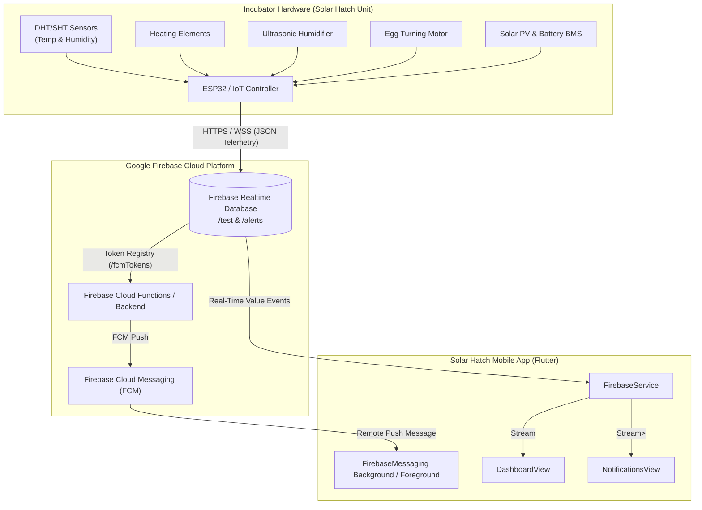
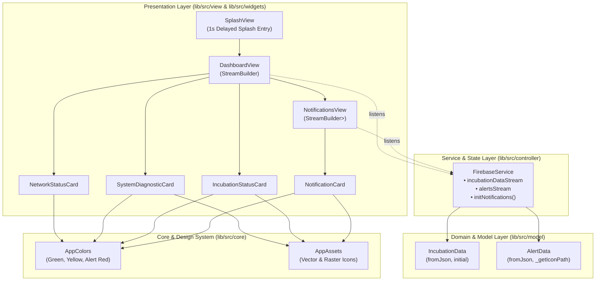
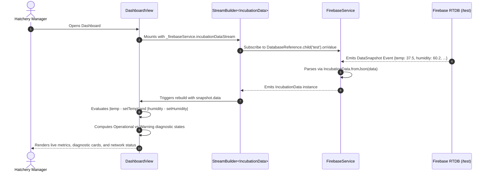
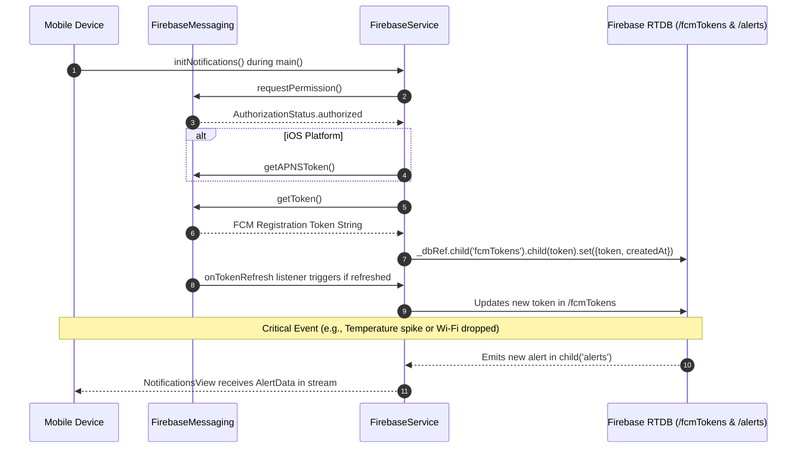

# Solar Hatch Mobile

[](https://flutter.dev)
[](https://dart.dev)
[](https://firebase.google.com)
[](https://pub.dev/packages/flutter_screenutil)
[](https://pub.dev/packages/very_good_analysis)
[](#prerequisites)

**Solar Hatch Mobile** is a specialized smart agriculture and IoT Flutter companion application engineered for real-time telemetry streaming, hardware diagnostics, and environmental monitoring of automated solar-powered egg incubators.

Connected directly to **Firebase Realtime Database (RTDB)** and **Firebase Cloud Messaging (FCM)**, the app gives hatchery managers, agronomists, and poultry farmers instant visibility into critical incubation vitals (temperature, humidity, motor turning, and power/network connectivity) to maximize egg hatchability and safeguard livestock embryos.

---

## Table of Contents

- [Overview](#overview)
- [Key Features](#key-features)
- [System Architecture](#system-architecture)
  - [Hardware to Cloud Topology](#hardware-to-cloud-topology)
  - [Application Architecture](#application-architecture)
  - [Real-Time Telemetry Flow](#real-time-telemetry-flow)
  - [Push Notification & Alert Flow](#push-notification--alert-flow)
- [Firebase Realtime Database Schema](#firebase-realtime-database-schema)
- [Project Directory Structure](#project-directory-structure)
- [Core Modules & Implementation Deep Dive](#core-modules--implementation-deep-dive)
  - [1. App Entry & Bootstrap (`main.dart` & `app.dart`)](#1-app-entry--bootstrap-maindart--appdart)
  - [2. Firebase Controller Service (`firebase_service.dart`)](#2-firebase-controller-service-firebase_servicedart)
  - [3. Data Models (`incubation_data.dart` & `alert_data.dart`)](#3-data-models-incubation_datadart--alert_datadart)
  - [4. Presentation Layer & Views](#4-presentation-layer--views)
  - [5. Diagnostic Logic & Threshold Rules](#5-diagnostic-logic--threshold-rules)
  - [6. Reusable Widgets](#6-reusable-widgets)
  - [7. Design System & Asset Management](#7-design-system--asset-management)
- [Getting Started & Installation](#getting-started--installation)
  - [Prerequisites](#prerequisites)
  - [Installation Steps](#installation-steps)
  - [Firebase Configuration](#firebase-configuration)
  - [Running the Application](#running-the-application)
- [Code Quality & Testing](#code-quality--testing)
  - [Static Analysis](#static-analysis)
  - [Widget & Unit Testing Guide](#widget--unit-testing-guide)
- [Troubleshooting & FAQs](#troubleshooting--faqs)
- [Contributing & License](#contributing--license)

---

## Overview

Precise temperature and humidity regulation, coupled with automated egg turning, are critical factors for successful artificial egg incubation. Fluctuations of even ±1.5°C or humidity dips can drastically reduce hatch rates. 

**Solar Hatch Mobile** provides an end-to-end telemetry dashboard that continuously monitors microcontroller-equipped solar incubators deployed in off-grid and on-grid farming environments. By capturing continuous environmental data and raising alerts when environmental thresholds deviate from setpoints, Solar Hatch prevents embryonic mortality and minimizes costly incubator failures.

---

## Key Features

- **Real-Time Telemetry Synchronization**:
  - Live streams temperature (°C), target set temperature, relative humidity (%RH), and target set humidity directly from Firebase Realtime Database without manual pull-to-refresh.
- **Automated Subsystem Diagnostics**:
  - **System Health**: Composite health evaluation that alerts users whenever any sensor, heater, humidifier, or network subsystem reports a fault.
  - **Humidifier Monitor**: Automatically computes setpoint variance and warns if relative humidity drifts by more than `5.0%RH`.
  - **Heater Monitor**: Tracks heating element performance and triggers a warning if temperature deviates by more than `1.0°C`.
  - **Motor Sensor**: Monitors automated egg turning actuators to ensure continuous mechanical rotation.
- **Incubation Cycle Tracking**:
  - Displays total incubation days (e.g., 21 days for chicken eggs).
  - Dynamically calculates **Days Left** countdown (`totalIncubationDays - currentIncubationDay`).
  - Tracks specific hatching phase transition days (`hatchingDays`).
- **Network & Hardware Connectivity State**:
  - Active detection of incubator Wi-Fi/cellular module connectivity (`wifiStatus == 1` vs `0`), displaying an instant connection banner.
- **Proactive Alerts & Push Notifications**:
  - Firebase Cloud Messaging (FCM) integration with background message processing.
  - Automatic device token provisioning and storage in Firebase RTDB (`fcmTokens`).
  - Dedicated notification center with unread badge states and category-specific iconography (humidifier, temperature, calendar, and system).
- **Responsive & Adaptive UI**:
  - Pixel-perfect rendering across varying device screen sizes using `flutter_screenutil` tailored to a 383x852 reference viewport.
  - Locked to portrait orientation to prevent accidental UI disorientations during on-site inspections.
  - Smooth platform-adaptive page transitions (Cupertino transitions on iOS, OpenUpwards on Android).

---

## System Architecture

### Hardware to Cloud Topology



---

### Application Architecture

The mobile application follows a structured, layered Flutter architecture with clear boundaries between data services, models, reactive streams, and reusable presentation components:



---

### Real-Time Telemetry Flow

The following sequence highlights how hardware telemetry is consumed reactively by the mobile user interface:



---

### Push Notification & Alert Flow



---

## Firebase Realtime Database Schema

The mobile application communicates with the Firebase project `smarteggincubator-5ee0f`. The database expects the following JSON data structure:

```json
{
  "test": {
    "currentIncubationDay": 12,
    "hatchingDays": 18,
    "humidity": 58.4,
    "setHumidity": 60.0,
    "setTemperature": 37.5,
    "temperature": 37.6,
    "totalIncubationDays": 21,
    "wifiStatus": 1
  },
  "alerts": {
    "-O8aBc123xyz": {
      "title": "Temperature Spike Detected",
      "description": "Incubator temperature reached 39.1°C. Check heating element.",
      "time": "10:32 AM",
      "isUnread": true,
      "iconType": "temperature"
    },
    "-O8aBc456uvw": {
      "title": "Humidifier Water Level Low",
      "description": "Humidity dropped below setpoint (48%RH). Refill water tray.",
      "time": "08:15 AM",
      "isUnread": false,
      "iconType": "humidifier"
    }
  },
  "fcmTokens": {
    "eXample_FCM_Token_ABC123...": {
      "token": "eXample_FCM_Token_ABC123...",
      "createdAt": 1729584000000
    }
  }
}
```

### Node Field Descriptions

| Path | Field | Type | Description |
| :--- | :--- | :--- | :--- |
| `/test` | `currentIncubationDay` | `int` | Number of days elapsed since incubation started. |
| `/test` | `hatchingDays` | `int` | Incubation day marking the transition to the hatching phase (lockdown). |
| `/test` | `humidity` | `double` | Current internal chamber relative humidity (%RH). |
| `/test` | `setHumidity` | `double` | Target setpoint for relative humidity (%RH). |
| `/test` | `setTemperature` | `double` | Target setpoint for internal temperature (°C). |
| `/test` | `temperature` | `double` | Current internal chamber temperature (°C). |
| `/test` | `totalIncubationDays` | `int` | Total duration of the incubation cycle (default: 21). |
| `/test` | `wifiStatus` | `int` | Hardware connectivity status: `1` = Connected, `0` = Disconnected. |
| `/alerts/{id}` | `title` | `String` | Header title of the alert notification. |
| `/alerts/{id}` | `description` | `String` | Detailed advisory or diagnostic description. |
| `/alerts/{id}` | `time` | `String` | Formatted timestamp string (e.g., `"10:30 AM"`). |
| `/alerts/{id}` | `isUnread` | `bool` | Flag determining visual highlight state (green card when true). |
| `/alerts/{id}` | `iconType` | `String` | Category key (`humidifier`, `temperature`, `calendar`, `system`). |
| `/fcmTokens/{token}` | `token` | `String` | FCM client token for targeted push message broadcasts. |
| `/fcmTokens/{token}` | `createdAt` | `timestamp` | Server timestamp when the device token was registered or refreshed. |

---

## Project Directory Structure

```
solar_hatch_mobile/
├── android/                        # Native Android configuration & Gradle files
│   └── app/src/main/
│       ├── AndroidManifest.xml     # Internet permission & app metadata
│       └── google-services.json    # Firebase Android configuration file
├── ios/                            # Native iOS configuration & Xcode project
│   └── Runner/
│       ├── GoogleService-Info.plist# Firebase iOS configuration file
│       └── Info.plist              # Bundle metadata, orientations, and permissions
├── assets/                         # Visual assets and diagnostic icons
│   ├── HourglassHigh_icon.png      # Header icon for Incubation Status section
│   ├── Pulse_icon.png              # Header icon for System Diagnostics section
│   ├── Splash.png                  # Full-bleed launch screen graphic
│   ├── calendar_icon.png           # Total incubation days metric icon
│   ├── dashboard_bg.png            # Diagnostics card decorative background pattern
│   ├── heater_icon.png             # Heater diagnostic indicator icon
│   ├── humidifier_icon.png         # Humidifier diagnostic indicator icon
│   ├── humidity_icon.png           # Chamber humidity status icon
│   ├── incubation_icon.png         # Days left countdown status icon
│   ├── logo.png                    # Brand banner logo for dashboard AppBar
│   ├── logo_icon.png               # Square application launcher icon
│   ├── motor_sensor_icon.png       # Egg turning motor actuator icon
│   ├── settings_icon.png           # System health diagnostic gear icon
│   └── temperature_icon.png        # Chamber temperature status icon
├── lib/                            # Dart source code root
│   ├── firebase_options.dart       # CLI-generated Firebase options for Android, iOS, Web
│   ├── main.dart                   # Application entry point, FCM background handler
│   ├── app.dart                    # SolarHatch root widget, ScreenUtilInit, Theme
│   └── src/
│       ├── controller/
│       │   └── firebase_service.dart # Firebase RTDB streaming & FCM token controller
│       ├── core/
│       │   ├── app_assets.dart     # Central asset file constants
│       │   └── app_colors.dart     # Design system color tokens
│       ├── model/
│       │   ├── alert_data.dart     # Alert domain model & icon resolver
│       │   └── incubation_data.dart# Incubator telemetry model & default factories
│       ├── view/
│       │   ├── dashboard_view.dart # Primary telemetry & diagnostic overview screen
│       │   ├── notifications_view.dart # Push notification list & dismissal view
│       │   └── splash_view.dart    # Animated initial loading view
│       └── widgets/
│           ├── incubation_status_card.dart  # Metric card (Value, title, category icon)
│           ├── network_status_card.dart     # Online/Offline connection status banner
│           ├── notification_card.dart       # Expandable alert card with unread styling
│           └── system_diagnostic_card.dart  # Subsystem health badge (Operational/Warning)
├── test/
│   └── widget_test.dart            # Flutter test suite
├── analysis_options.yaml           # Very Good Analysis lint rules & overrides
├── firebase.json                   # Firebase CLI project binding configuration
├── pubspec.yaml                    # Package dependencies & asset declarations
└── README.md                       # Comprehensive project documentation
```

---

## Core Modules & Implementation Deep Dive

### 1. App Entry & Bootstrap (`main.dart` & `app.dart`)

The app startup initializes core native and cloud bindings synchronously before rendering frames:

```dart
// lib/main.dart
@pragma('vm:entry-point')
Future<void> _firebaseMessagingBackgroundHandler(RemoteMessage message) async {
  await Firebase.initializeApp(options: DefaultFirebaseOptions.currentPlatform);
  debugPrint('Handling a background message: ${message.messageId}');
}

void main() async {
  WidgetsFlutterBinding.ensureInitialized();
  await Firebase.initializeApp(options: DefaultFirebaseOptions.currentPlatform);

  FirebaseMessaging.onBackgroundMessage(_firebaseMessagingBackgroundHandler);

  try {
    await FirebaseService().initNotifications();
  } catch (e) {
    debugPrint('Failed to init notifications: $e');
  }

  unawaited(
    SystemChrome.setPreferredOrientations([
      DeviceOrientation.portraitUp,
      DeviceOrientation.portraitDown,
    ]),
  );

  runApp(const SolarHatch());
}
```

- **Background FCM Execution**: The `@pragma('vm:entry-point')` annotation ensures the Dart AOT compiler does not tree-shake the background isolate handler, allowing remote push notifications to execute even when the application is terminated.
- **Fail-Safe Startup**: The `initNotifications()` invocation is wrapped in a `try-catch` block so network instability or push permission denials never crash the initial app startup.
- **Orientation Lock**: Enforces portrait modes to eliminate layout distortion in farm environments.

In `lib/app.dart`:
- Wrapped with `ScreenUtilInit(designSize: Size(383, 852), minTextAdapt: true, splitScreenMode: true)` to ensure that all layout dimensions, font sizes (`.spMin`), radii (`.r`), and margins scale proportionately on both compact and large phones.
- Configures custom `PageTransitionsTheme` (Cupertino on iOS and OpenUpwards on Android) for smooth visual transitions.

---

### 2. Firebase Controller Service (`firebase_service.dart`)

Located at `lib/src/controller/firebase_service.dart`, this class acts as the single gateway for all network and Firebase operations:

- **`incubationDataStream`**:
  ```dart
  Stream<IncubationData> get incubationDataStream {
    return _dbRef.child('test').onValue.map((event) {
      final data = event.snapshot.value as Map<dynamic, dynamic>?;
      if (data != null) {
        return IncubationData.fromJson(data);
      }
      return IncubationData.initial();
    });
  }
  ```
  Listens continuously to mutations on the `/test` RTDB path. If data is null or empty, it yields `IncubationData.initial()` to prevent null reference errors on the UI.

- **`alertsStream`**:
  ```dart
  Stream<List<AlertData>> get alertsStream {
    return _dbRef.child('alerts').onValue.map((event) {
      final data = event.snapshot.value as Map<dynamic, dynamic>?;
      if (data != null) {
        final alerts = <AlertData>[];
        data.forEach((key, value) {
          alerts.add(AlertData.fromJson(key.toString(), value as Map<dynamic, dynamic>));
        });
        return alerts.reversed.toList();
      }
      return [];
    });
  }
  ```
  Converts RTDB key-value alert nodes into strongly-typed `AlertData` objects, reversing the order so the newest notifications appear at the top.

- **`initNotifications()`**:
  - Requests user permissions (`requestPermission()`).
  - **iOS/macOS APNS Verification**: Explicitly verifies `getAPNSToken() != null` before calling `getToken()`. This prevents crashes and token fetch exceptions when debugging on iOS Simulators where remote push notifications are unsupported.
  - Registers the active token under `/fcmTokens/{token}` with a `ServerValue.timestamp`.
  - Attaches an `onTokenRefresh` listener to auto-sync rotated tokens.

---

### 3. Data Models (`incubation_data.dart` & `alert_data.dart`)

#### `IncubationData` (`lib/src/model/incubation_data.dart`)
Encapsulates real-time telemetry with safe numeric type casting:
```dart
factory IncubationData.fromJson(Map<dynamic, dynamic> json) {
  return IncubationData(
    currentIncubationDay: (json['currentIncubationDay'] as num?)?.toInt() ?? 0,
    hatchingDays: (json['hatchingDays'] as num?)?.toInt() ?? 0,
    humidity: (json['humidity'] as num?)?.toDouble() ?? 0.0,
    setHumidity: (json['setHumidity'] as num?)?.toDouble() ?? 0.0,
    setTemperature: (json['setTemperature'] as num?)?.toDouble() ?? 0.0,
    temperature: (json['temperature'] as num?)?.toDouble() ?? 0.0,
    totalIncubationDays: (json['totalIncubationDays'] as num?)?.toInt() ?? 0,
    wifiStatus: (json['wifiStatus'] as num?)?.toInt() ?? 0,
  );
}
```
Using `num?` casting guarantees safe parsing regardless of whether the Firebase JSON backend transmits integers (`37`) or floating-point numbers (`37.0`).

#### `AlertData` (`lib/src/model/alert_data.dart`)
Parses notifications and maps category keys to local design assets:
```dart
static String _getIconPath(String? type) {
  switch (type) {
    case 'humidifier':
      return AppAssets.humidifierIcon;
    case 'temperature':
      return AppAssets.temperatureIcon;
    case 'calendar':
      return AppAssets.calendarIcon;
    case 'system':
    default:
      return AppAssets.settingsIcon;
  }
}
```

---

### 4. Presentation Layer & Views

#### `SplashView` (`lib/src/view/splash_view.dart`)
- Full-screen brand intro displaying `AppAssets.splashBG`.
- Uses a post-frame callback with a 1-second delay to smoothly transition (`Navigator.pushReplacement`) into `DashboardView`.

#### `DashboardView` (`lib/src/view/dashboard_view.dart`)
- **Header**: Displays the official Solar Hatch logo and an interactive notifications bell that opens `NotificationsView`.
- **Reactive Body**: Consumes `_firebaseService.incubationDataStream` inside a `StreamBuilder`.
- **Network Status**: Instantiates `NetworkStatusCard(isConnected: data.wifiStatus == 1)`.
- **Diagnostics Card**: A themed gradient container with a translucent background pattern (`dashboard_bg.png`) hosting a 2x2 grid of `SystemDiagnosticCard` widgets.
- **Incubation Status**: Vertical card stack displaying:
  - Temperature (`data.temperature°C`)
  - Humidity (`data.humidity%RH`)
  - Total Days (`data.totalIncubationDays`)
  - Days Left (`data.totalIncubationDays - data.currentIncubationDay`)

#### `NotificationsView` (`lib/src/view/notifications_view.dart`)
- Consumes `_firebaseService.alertsStream`.
- Displays real-time alert history with unread indicators and a "Dismiss All" action header.

---

### 5. Diagnostic Logic & Threshold Rules

The telemetry data stream dynamically drives diagnostic states computed inside `DashboardView`:

```dart
// Humidifier warning threshold: variance > 5.0 %RH
final humidityDiff = (data.humidity - data.setHumidity).abs();
final isHumidifierWarning = humidityDiff > 5.0;

// Heater warning threshold: variance > 1.0 °C
final tempDiff = (data.temperature - data.setTemperature).abs();
final isHeaterWarning = tempDiff > 1.0;

// System health composite warning:
final isSystemWarning = isHumidifierWarning || isHeaterWarning || data.wifiStatus == 0;
```

#### Diagnostic States Matrix

| Subsystem | Metric Monitored | Safe Threshold | Operational Label | Warning Label |
| :--- | :--- | :--- | :--- | :--- |
| **Humidifier** | `abs(humidity - setHumidity)` | $\le 5.0\,\text{\%RH}$ | `Humidity stable` | `Humidity out of range` |
| **Heater** | `abs(temperature - setTemperature)` | $\le 1.0\,^\circ\text{C}$ | `Temperature stable` | `Temp out of range` |
| **System Health** | Humidifier, Heater, Wi-Fi | All operational & Wi-Fi = 1 | `All systems Normal` | `Check subsystems` |
| **Motor Sensor** | Egg turning actuator | Continuous telemetry | `Operational` | `Operational` |

---

### 6. Reusable Widgets

| Widget | File | Purpose |
| :--- | :--- | :--- |
| `NetworkStatusCard` | `lib/src/widgets/network_status_card.dart` | Full-width container indicating Wi-Fi connectivity (`Connected` / `Disconnected`) with dynamic Wi-Fi icon states. |
| `SystemDiagnosticCard` | `lib/src/widgets/system_diagnostic_card.dart` | Grid card featuring subsystem icon, title, colored status dot (Green for operational, Amber for warning), status tag, and condition summary. |
| `IncubationStatusCard` | `lib/src/widgets/incubation_status_card.dart` | Telemetry metric row card with circular icon avatar, metric name, and large formatted reading. |
| `NotificationCard` | `lib/src/widgets/notification_card.dart` | Alert card featuring unread visual contrast (dark green background when unread), timestamp, category icon, and dismiss button. |

---

### 7. Design System & Asset Management

#### Color Palette (`lib/src/core/app_colors.dart`)

```dart
class AppColors {
  static const Color primaryDarkGreen = Color(0xFF003B24); // Primary brand color, headers, cards
  static const Color accentYellow     = Color(0xFFF6A820); // Warning accents, notification bell, icons
  static const Color statusOperational= Color(0xFF4CAF50); // Vibrant green status badge
  static const Color statusWarning    = Color(0xFFF9A825); // Amber status badge
  static const Color backgroundScaffold= Color(0xFFF5F5F5); // Soft neutral background
  static const Color textDark         = Color(0xFF1B2A22); // High-contrast text
  static const Color textLight        = Colors.white;      // Inverted white text
  static const Color cardBackground   = Colors.white;      // Surface elevation color
  static const Color alertRed         = Color(0xFFFF9E9E); // Dismiss badge background
  static const Color alertRedText     = Color(0xFFD32F2F); // Dismiss badge text
}
```

---

## Getting Started & Installation

### Prerequisites

Ensure the following tools are installed in your development environment:
- **[Flutter SDK](https://docs.flutter.dev/get-started/install)**: Version `3.10.8` or newer (Dart SDK `>=3.10.8 <4.0.0`)
- **[Android Studio](https://developer.android.com/studio)** / **Xcode** (for macOS iOS development)
- **[Firebase CLI](https://firebase.google.com/docs/cli)** (optional, if modifying cloud bindings)

Check your environment setup by running:
```bash
flutter doctor
```

---

### Installation Steps

1. **Clone the repository**:
   ```bash
   git clone https://github.com/devinnov8hub-code/Solar-hatch-mobile.git
   cd Solar-hatch-mobile
   ```

2. **Install project dependencies**:
   ```bash
   flutter pub get
   ```

3. **Verify asset registration and dependencies**:
   ```bash
   flutter pub run flutter_launcher_icons
   ```

---

### Firebase Configuration

The application is pre-configured with Firebase project `smarteggincubator-5ee0f`. The credentials and options are maintained in:
- Android: `android/app/google-services.json`
- iOS: `ios/Runner/GoogleService-Info.plist`
- Flutter/Dart: `lib/firebase_options.dart`

To reconfigure or link to a custom Firebase project:
```bash
flutterfire configure --project=<your-firebase-project-id>
```

---

### Running the Application

Launch the app on a connected physical device or emulator:

```bash
# Debug mode
flutter run

# Run on a specific device
flutter run -d <device_id>

# Build release APK for Android
flutter build apk --release

# Build iOS archive
flutter build ipa --release
```

---

## Code Quality & Testing

### Static Analysis

This project enforces strict code style guidelines powered by [`package:very_good_analysis`](https://pub.dev/packages/very_good_analysis). Custom rule configurations are maintained in `analysis_options.yaml`.

To execute static analysis across the entire project:
```bash
flutter analyze
```

---

### Widget & Unit Testing Guide

Because this application relies on `flutter_screenutil` for scaling, any widget tests rendering presentation components must be wrapped in `ScreenUtilInit` or a test harness helper.

#### Example: Testing `NetworkStatusCard`

Create `test/widgets/network_status_card_test.dart`:

```dart
import 'package:flutter/material.dart';
import 'package:flutter_screenutil/flutter_screenutil.dart';
import 'package:flutter_test/flutter_test.dart';
import 'package:solar_hatch_mobile/src/widgets/network_status_card.dart';

Widget createTestableWidget(Widget child) {
  return ScreenUtilInit(
    designSize: const Size(383, 852),
    minTextAdapt: true,
    builder: (context, _) => MaterialApp(
      home: Scaffold(body: child),
    ),
  );
}

void main() {
  testWidgets('NetworkStatusCard displays Connected when isConnected is true', (tester) async {
    await tester.pumpWidget(createTestableWidget(const NetworkStatusCard(isConnected: true)));
    await tester.pumpAndSettle();

    expect(find.text('Connected'), findsOneWidget);
    expect(find.byIcon(Icons.wifi), findsOneWidget);
  });

  testWidgets('NetworkStatusCard displays Disconnected when isConnected is false', (tester) async {
    await tester.pumpWidget(createTestableWidget(const NetworkStatusCard(isConnected: false)));
    await tester.pumpAndSettle();

    expect(find.text('Disconnected'), findsOneWidget);
    expect(find.byIcon(Icons.wifi_off), findsOneWidget);
  });
}
```

To run all project tests:
```bash
flutter test
```

---

## Troubleshooting & FAQs

### 1. `FirebaseException: [firebase_database/permission-denied]`
- **Cause**: Firebase Realtime Database security rules are set to private and deny unauthenticated read access.
- **Solution**: In the Firebase Console under **Realtime Database > Rules**, configure read permissions appropriate for your deployment (e.g., `".read": true` for public monitoring or authenticated read access).

### 2. Push Notifications Not Delivering on iOS Simulator
- **Cause**: Apple Push Notification Service (APNS) does not support remote push notifications on certain older iOS simulator targets.
- **Solution**: The code in `lib/src/controller/firebase_service.dart` contains a defensive check for `getAPNSToken() == null` on iOS/macOS. Test push notifications on a physical iOS device provisioned with an Apple Developer profile.

### 3. Font or Layout Scaling Irregularities
- **Cause**: Instantiating widgets outside the `ScreenUtilInit` widget tree.
- **Solution**: Ensure custom routes or dialogs are built within the root `MaterialApp` initialized inside `app.dart`.

---

## Contributing & License

1. **Fork the Repository** and create a feature branch (`git checkout -b feature/NewFeature`).
2. **Commit your changes** following clear commit conventions (`git commit -m 'Add support for battery voltage telemetry'`).
3. **Verify Code Quality**: Ensure `flutter analyze` returns zero errors and all unit tests pass (`flutter test`).
4. **Push to the branch** (`git push origin feature/NewFeature`) and open a Pull Request.

---

*Engineered with Flutter for smart agricultural efficiency and sustainable solar incubation.*


cd functions
npm install
cd ..
firebase deploy --only functions
